# Исследование конкурентов BirdQuest

*Дата: 17.10.2026. Устройство: Xiaomi 2312DRAABG, Android 15, Wi‑Fi. Скриншоты лежат в [competitor-research/](competitor-research/). Точный адрес, GPS-координаты и Device ID на них закрашены.*

## Как проводилось

**Установлено из Google Play и пройдено вручную (6 приложений):**

| Приложение | Пакет | Размер в Play | Рейтинг / установки |
|---|---|---|---|
| Merlin Bird ID (Cornell Lab) | `com.labs.merlinbirdid.app` | 200 MB | ★4.8 / 10M+ |
| BirdNET (TU Chemnitz + Cornell) | `de.tu_chemnitz.mi.kahst.birdnet` | 33 MB | ★4.5 / 5M+ |
| Picture Bird (Next Vision) | `com.glority.picturebird` | 35 MB | ★4.1 / 1M+ |
| Birda | `com.chirpbirding.birda` | 105 MB | — / 100K+ |
| Seek by iNaturalist | `org.inaturalist.seek` | 106 MB | ★4.1 / 1M+ |
| European Birds Songs & Calls (EcoSystem) | `ru.ecosystema.birdsounds_europe` | 208 MB | ★4.8 / 100K+ |

**Изучены по описаниям, справке и GitHub, без установки:** eBird, iNaturalist, BirdNET Live (216 MB).

**Не подошли:** Bird Song Id (Sunbird) несовместим с Android 15. Birdex доступен только по предрегистрации, но его концепт (*«collect cards, build your life list»*) стоит отслеживать.

**Ограничения:**
- В Merlin нужен email, в Birda нужен вход через Google/аккаунт. По решению пользователя вход пропущен. Эти два приложения описаны по экранам до входа и по справке/обзорам (помечено *(desk)*).
- Ничего не покупалось. Платные функции разобраны по paywall-экранам.
- Настоящей птицы рядом не было, поэтому реальную точность определения не проверяли (см. Picture Bird ниже: это само по себе показательно).
- Региональные паки не скачивались. У Merlin они за логином, BirdNET и Seek работают со встроенной моделью, у EcoSystem контент уже в APK.

> Побочное наблюдение: на Xiaomi ссылка `market://details?id=…` открывается в **Xiaomi GetApps**, а не в Google Play, и GetApps сам ставит приложение. Merlin так установился из GetApps. Я его удалила и поставила заново из Play. Если BirdQuest где-то откроет `market://` (например, «Оцените нас»), на Xiaomi пользователь попадёт в GetApps. Надёжнее явно указывать `com.android.vending` или https-ссылку на Play.

---

## Матрица функций

Обозначения: ✅ есть · ◐ частично / платно · ❌ нет · ? не удалось проверить. BQ = BirdQuest на коммите `742c0e4`.

| Функция | **BQ** | Merlin | BirdNET | BirdNET Live *(desk)* | Picture Bird | Birda | Seek | EcoSystem |
|---|---|---|---|---|---|---|---|---|
| ID по звуку, live | ✅ | ✅ | ◐ запись → выделение → анализ | ✅ | ✅ запись → результат | ❌ | ❌ | ❌ |
| ID по фото | ❌ | ✅ | ❌ | ❌ | ✅ | ✅ | ✅ live-камера | ❌ |
| Пошаговый определитель («5 вопросов») | ❌ | ✅ | ❌ | ❌ | ❌ | ◐ текстом | ❌ | ❌ |
| Спектрограмма на экране | ❌ (уровень/волна) | ✅ | ✅ + настройки цвета/усиления | ✅ | ❌ | ❌ | — | ❌ |
| Выбор фрагмента записи для анализа | ❌ | ✅ | ✅ | ✅ | ❌ | — | — | — |
| Фильтр по месту и сезону | ✅ geomodel | ✅ | ✅ eBird, неделя/год | ✅ | ❌ (филин из США во Вьетнаме) | ? | ✅ | ◐ выбор региона |
| Полностью офлайн | ✅ | ✅ с паками | ✅ (анализ на устройстве, проверить) | ✅ | ❌ облако | ❌ | ✅ (облегчённая модель) | ✅ |
| Региональные паки | ✅ энциклопедия по области | ✅ «My offline birds», автообновление | ❌ | — | ❌ | ❌ | ❌ | ◐ платные регионы |
| «Птицы рядом сейчас» | ✅ чек-лист региона | ✅ Explore | ✅ Explore (eBird) | ✅ | ◐ Hotspots, данных нет | ✅ | ✅ Species Nearby | ❌ |
| Коллекция / лайф-лист | ✅ | ✅ (eBird life list) | ◐ список записей | ✅ Session Library | ✅ My Collections | ✅ много лайф-листов | ✅ | ◐ избранное |
| Фото своих встреч | ✅ | ◐ | ❌ | ❌ | ✅ | ✅ | ✅ | ❌ |
| Экспорт (CSV/GPX/eBird) | ❌ | ✅ в eBird | ◐ | ✅ CSV/JSON/GPX/Raven | ❌ | ✅ импорт/экспорт | ✅ в iNat | ❌ |
| Карта своих наблюдений | ✅ | ◐ через eBird | ❌ | ✅ GPS-трансекты | ❌ | ✅ | ❌ | ❌ |
| Ареал вида на карте | ❌ | ✅ | ❌ | ❌ | ✅ (Google Maps) | ✅ | ✅ | ❌ |
| Сезонность вида (график по месяцам) | ❌ | ✅ | ❌ | ❌ | ❌ | ? | ✅ | ❌ |
| Похожие виды | ❌ | ✅ | ❌ | ❌ | ✅ | ? | ✅ | ❌ |
| Эталонные голоса в карточке | ◐ свой клип | ✅ | ❌ | ❌ | ✅ | ✅ | ❌ | ✅ (ядро продукта: песня/позыв, повтор, цикл) |
| Описание вида | ✅ Википедия EN/RU | ✅ | ❌ | ❌ | ◐ платно «Learn more» | ✅ | ✅ Википедия + таксономия | ✅ + синонимы |
| Достижения / бейджи | ✅ 21 | ❌ | ❌ | ❌ | ❌ | ✅ | ✅ по группам таксонов | ❌ |
| Уровни / XP | ✅ 7 рангов | ❌ | ❌ | ❌ | ❌ | ? | ✅ (Tadpole → …) | ❌ |
| Ежедневные квесты / челленджи | ✅ 3 в день + серия | ❌ | ❌ | ❌ | ❌ | ✅ + свои + призы | ◐ ежемесячные (последний: дек. 2024) | ❌ |
| Редкость | ✅ | ❌ | ◐ «Frequent» в Explore | ❌ | ❌ | ❌ | ◐ «Native» | ❌ |
| Викторина по голосам | ❌ | ❌ | ❌ | ❌ | ❌ | ❌ | ❌ | ✅ |
| Сообщество / соцсеть | ❌ | ❌ | ◐ отправка записей | ❌ | ❌ | ✅ | ✅ iNat | ❌ |
| Аккаунт обязателен | ❌ | ✅ email | ❌ | ❌ | ❌ (paywall) | ✅ | ❌ | ❌ |
| Русский язык UI | ✅ | ? | ✅ (имена видов) | ✅ | ? | ? | ✅ | ? |
| Модель монетизации | — | бесплатно | бесплатно | бесплатно, open source | подписка ≈752 000 ₫/год, триал 7 дн. | реклама + Birda+ | бесплатно, донаты | демо 3 раза в день; $12 навсегда за регион |

---

## Приложения по отдельности

### Merlin Bird ID: эталон по UX, но за email
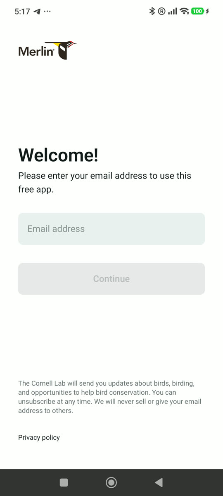

- Стартовый экран: *«Please enter your email address to use this free app»*. Без email дальше не пускает. Это барьер для новичков, у BirdQuest его нет.
- *(desk)* **Sound ID live**: спектрограмма бежит сверху, ниже список видов с фото. При повторном пении строка подсвечивается жёлтым. После записи можно тапнуть вид и перейти к его фрагменту или выделить участок спектрограммы. Записи сохраняются автоматически.
- *(desk)* **«This is my bird!»** добавляет вид в лайф-лист, связанный с eBird. В Explore можно скрыть уже встреченных птиц.
- *(desk)* **My offline birds**: регионы выбираются в настройках. Пак для текущего места **качается автоматически**, пока есть сеть, и периодически обновляется. В паке по несколько образцов звука на вид, «Download more sounds» добирает остальные. «Clean up space» чистит ненужное. Sound/Photo ID работают офлайн и без паков, просто без карточек видов.
- Геймификации нет совсем.

### BirdNET: научный инструмент, честный, но сухой
| | | | |
|---|---|---|---|
| 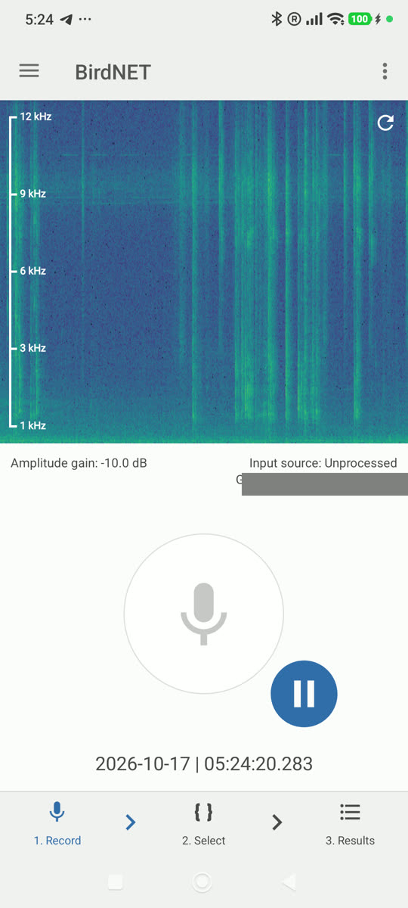 | 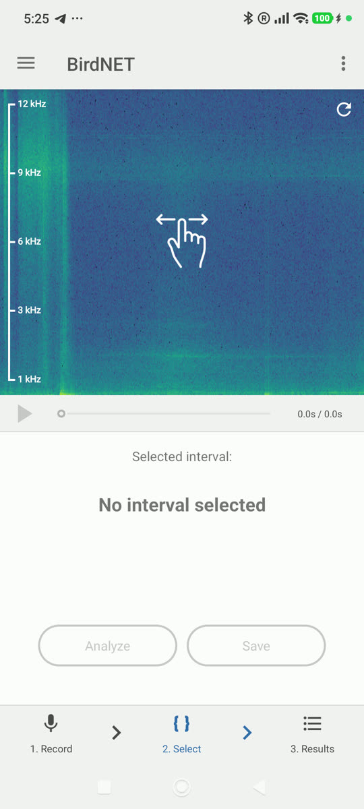 | 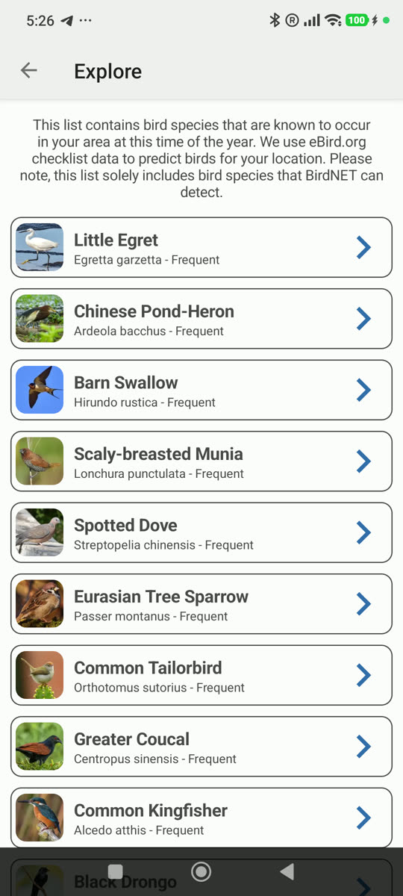 | 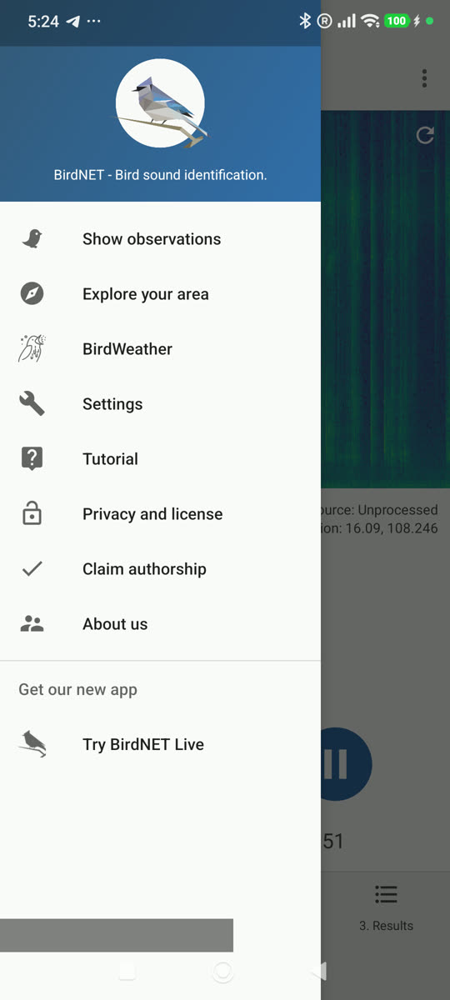 |

- Онбординг: одно окно с объяснением, зачем нужны микрофон и GPS. Затем промо BirdNET Live и предложение пройти туториал (длинный текст в 3 разделах).
- Поток в 3 шага внизу экрана: **1. Record → 2. Select → 3. Results**. Пользователь сам выделяет на спектрограмме интервал и жмёт Analyze или Save.
- Над записью и в настройках много ручек: цветовая схема, усиление (dB), длина спектрограммы, макс. частота, контраст, источник звука (Unprocessed).
- **Species selection**: виды за неделю или за год для вашего места. Чувствительность детекции. Язык имён видов.
- **Explore your area**: список видов «известных здесь в это время года» по чек-листам eBird с пометкой Frequent.
- **Observations**: All / By species. Записи можно отправить в BirdNET под CC BY-SA. Кнопки BirdWeather и Claim authorship.
- Геймификации и фото нет.

### Picture Bird: агрессивная монетизация и ложные срабатывания
| | | | |
|---|---|---|---|
| 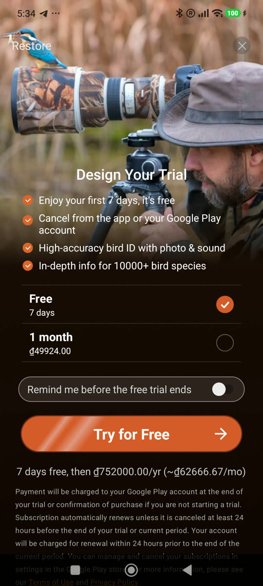 | 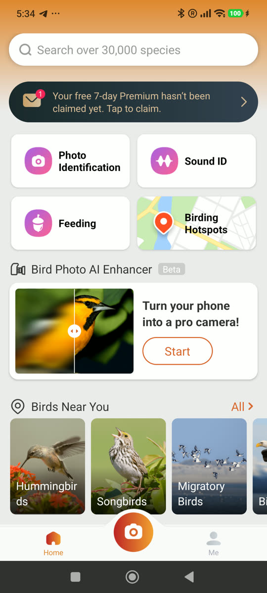 | 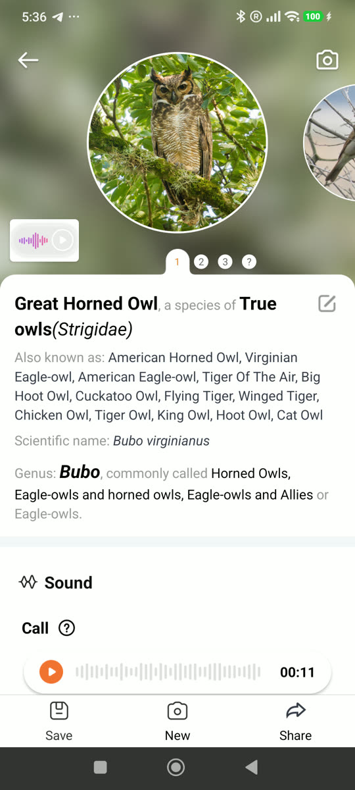 | 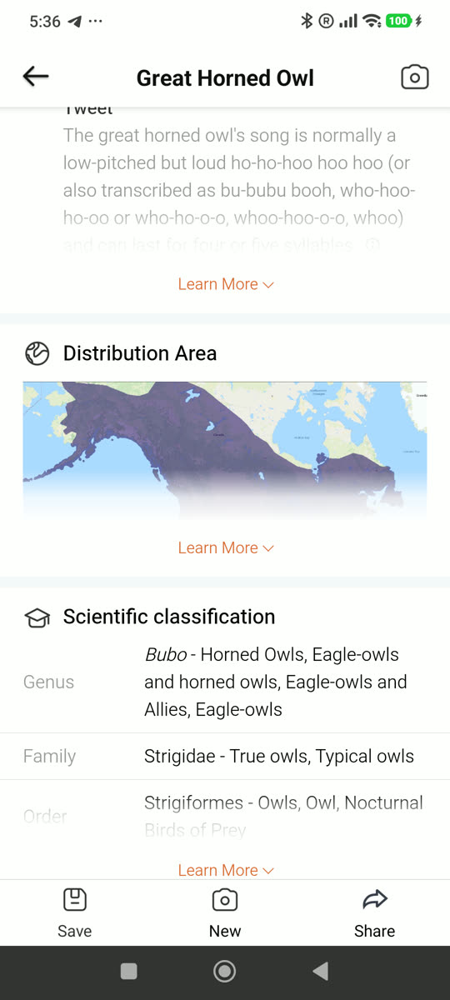 |

- Сразу после принятия условий показывается **paywall** «Design Your Trial»: 7 дней бесплатно, потом ≈752 000 ₫/год, либо 1 месяц за 49 924 ₫. После крестика идёт второй paywall «How your free trial works». Дальше баннер «Your free 7-day Premium hasn't been claimed yet» на главной. «Learn more» в карточке вида тоже ведёт на paywall.
- Главная: поиск по 30 000 видам, плитки **Photo ID, Sound ID, Feeding, Birding Hotspots, Bird Photo AI Enhancer (Beta)**, «Turn your phone into a pro camera», «Birds Near You» по категориям, статьи.
- **Sound ID**: 11 с тишины в комнате в Дананге дали **«Great Horned Owl»**, американский вид, в 3 вариантах выбора. Нет ни «птица не обнаружена», ни фильтра по местности. Результат автоматически попал в «My Collections». Это хороший контрпример: честность BirdQuest («не уверен», фильтр по geomodel, отсутствие сохранения без действия пользователя) стоит подавать как преимущество.
- Карточка вида: фото-карусель, «Also known as», род, звук (Call), описание, поведение, «How to identify», **ареал (Google Maps)**, научная классификация. Кнопки Save / New / Share.
- Hotspots: карта Google с радиусом 100 км, вкладки Spots / Likely Birds. Для Вьетнама данных нет.
- Настройки: Premium status, профиль, язык, автосохранение фото в галерею, FAQ, «Encourage us» (оценка).

### Birda: социальная сеть с челленджами
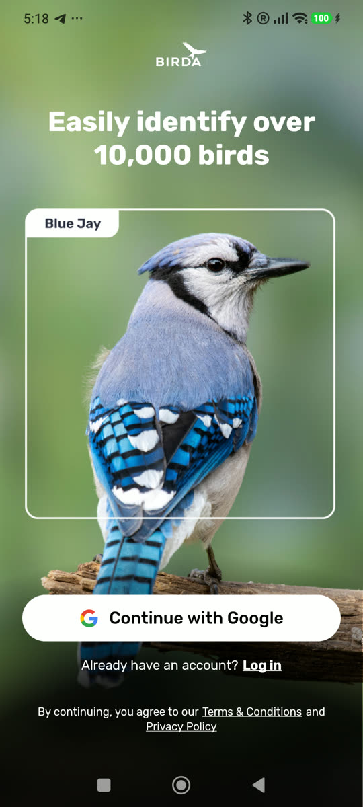

- Стартовый экран: *«Easily identify over 10,000 birds»*, анимация фото-ID с рамкой. Сразу просит «Continue with Google» или Log in, гостевого режима нет. Рейтинг 12+, есть реклама.
- *(desk)* ID по фото и текстовому описанию, плюс помощь сообщества. **Sound ID нет**: пользователи просят его в отзывах, это ниша BirdQuest.
- *(desk)* Логи сессий, **несколько лайф-листов** (сад / «патч» / страна / мир), импорт из eBird/Merlin/iNaturalist/BirdTrack/BirdLasser, экспорт, передача данных в GBIF, **приватные зоны вокруг дома**.
- *(desk)* **Челленджи**, включая пользовательские, бейджи, вехи, розыгрыши призов. Birda+ (≈$25–60/год): неограниченные приватные челленджи, авто-лайф-листы по регионам, «New Species for You» на точке, личные цели.

### Seek by iNaturalist: лучшая детская/семейная геймификация
| | | | |
|---|---|---|---|
| 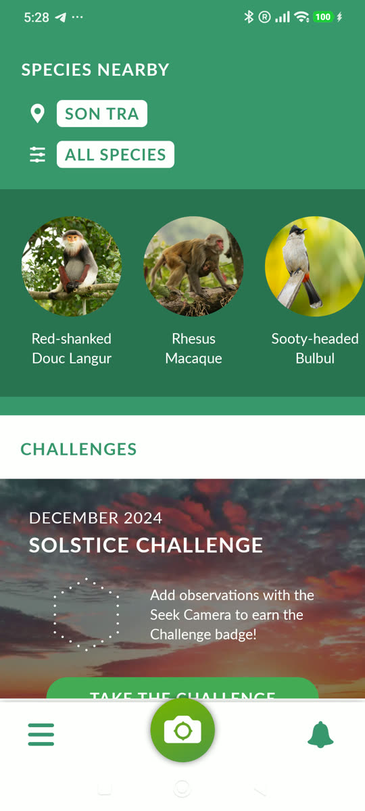 | 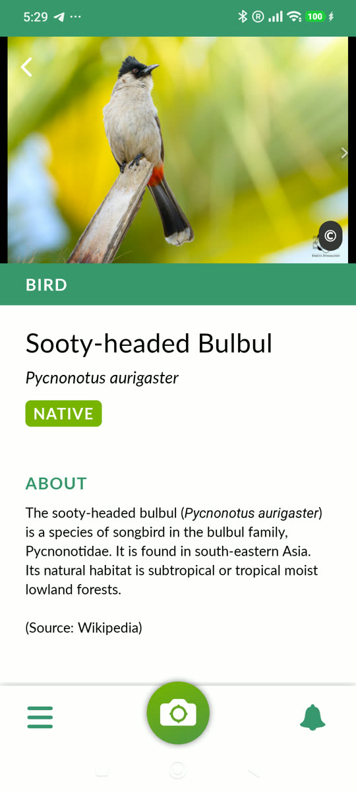 | 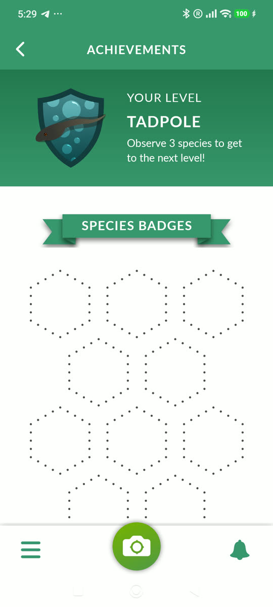 | 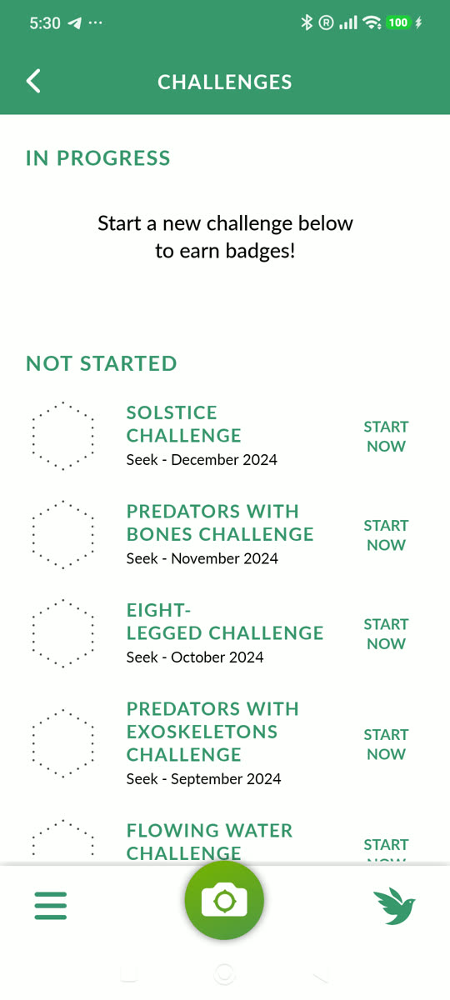 |

- Онбординг из 3 слайдов: камера, «Learn about the organisms all around you», «Earn badges». Затем гео-разрешение и карточка «Tips for getting started». Перед камерой показывается памятка безопасности («не ешь найденное, не трогай животных, детям нужен взрослый»).
- Главная: **Species Nearby** с выбором места (район) и фильтром групп. Под ним **Challenges** и кнопка «Take the challenge».
- Карточка вида: фото, группа (BIRD), Native, описание из Википедии, **range map**, **таксономия с народными названиями уровней**, наблюдения рядом и в мире (250 / 10 189), **график сезонности**, **похожие виды**.
- **Achievements**: уровень (*Tadpole*, «Observe 3 species to get to the next level!»), **бейджи по группам** (15 птиц, 15 амфибий, …, 20 растений), бейджи челленджей.
- **Challenges**: ежемесячные тематические (Solstice, Predators with Bones, Eight‑legged…), но последний датирован **декабрём 2024**. Заброшенный контент выглядит хуже, чем никакой, поэтому квесты BirdQuest стоит генерировать процедурно, как сейчас.
- Настройки: имена (обычные/научные), авто-снимок при определении до вида, сезонность по миру или «рядом со мной», язык, донаты.
- Распознавание только по фото, звука нет.

### European Birds Songs & Calls (EcoSystem): энциклопедия голосов
| | | | |
|---|---|---|---|
| 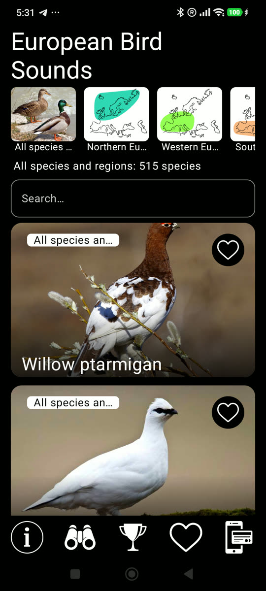 | 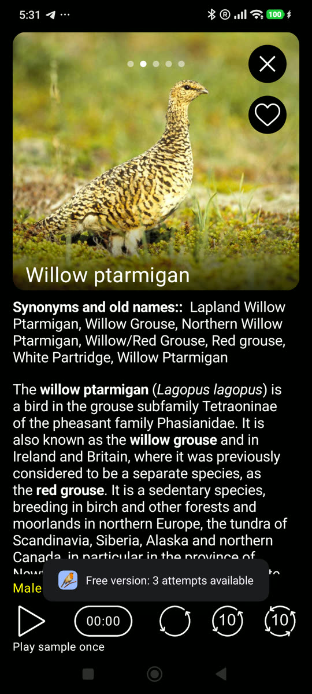 | 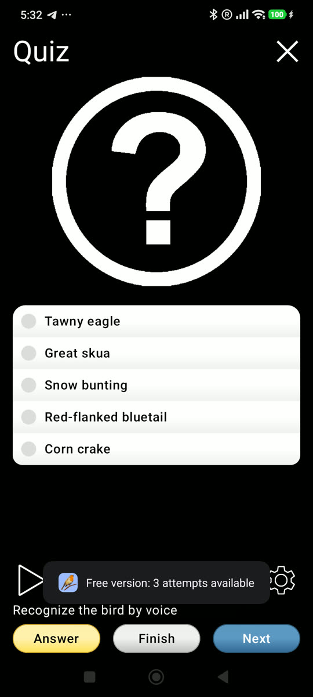 | 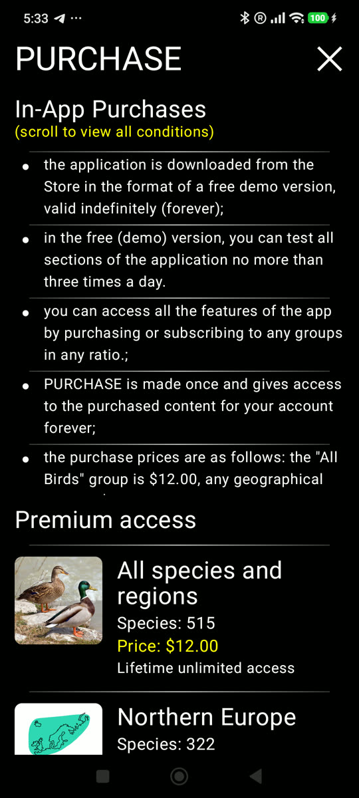 |

- Первый экран: **«PROTECT BIRDS FROM STRESS!»**, просьба не проигрывать голоса подолгу, особенно в сезон гнездования. Это этичный момент, BirdQuest стоит позаимствовать его для воспроизведения клипов.
- Регионы (Северная / Западная / Южная Европа, все 515 видов), поиск, большие карточки с избранным.
- Карточка вида: фото-карусель, синонимы и старые названия, текст, список записей (*Male demonstrations, Male calls*). Плеер с режимами **один раз / по кругу / по кругу с паузой / все с паузой**.
- **Quiz: «Recognize the bird by voice»**: проигрывается голос, на выбор 5 вариантов с фото, кнопки Answer / Finish / Next.
- Монетизация: демо **«не более 3 раз в день»** для каждого раздела, покупка навсегда **по регионам** (все 515 видов за $12), есть и подписка на год. Разработчик российский, у «Птиц России» есть аналоги.

### eBird, iNaturalist, BirdNET Live *(desk)*
- **eBird**: не определитель, а чек-листы (вид × количество, трек, дистанция) с синком в аккаунт. Это стандарт научного учёта. «Отправить в eBird» и импорт оттуда стали бы мостиком для продвинутых пользователей.
- **iNaturalist**: сила в сообществе (подтверждение ID другими людьми, проекты), слабый офлайн на Android. Новое приложение выйдет на Android в 2027 году, импорт звуков в планах.
- **BirdNET Live**: та же модель BirdNET+, что у BQ. Режимы Live / Point Count (таймер) / Survey (GPS-трансект) / File Analysis (WAV/FLAC/MP3/OGG) / ARU (многодневная запись). Экспорт CSV/JSON/GPX/Raven/ZIP, 12 языков, включая русский. Геймификации нет, это «профессиональный» сегмент.

---

## Чего нет у BirdQuest (а у конкурентов есть)

1. **Спектрограмма** в сканере и обзор записи с выбором фрагмента (Merlin, BirdNET, BirdNET Live).
2. **Эталонные голоса** вида в карточке, а не только свой записанный клип (Merlin, EcoSystem, Picture Bird).
3. **ID по фото** (Merlin, Picture Bird, Birda, Seek). Это крупная фича с моделью и лицензиями.
4. **Ареал** и **сезонность по месяцам** в карточке вида (Seek, Merlin, Picture Bird).
5. **Похожие виды** в карточке (Seek, Merlin, Picture Bird).
6. **Экспорт / шаринг**: CSV/GPX, «поделиться находкой» картинкой, eBird (Birda, BirdNET Live, Picture Bird Share).
7. **Анализ файла**: открыть существующую запись WAV/MP3 (BirdNET Live).
8. **Викторина по голосам** (EcoSystem).
9. **«5 вопросов»**: определитель по признакам (Merlin).
10. **Автоскачивание** офлайн-данных для текущего места (Merlin). В BQ область выбирается вручную, есть кнопка Update.
11. **Несколько лайф-листов** (двор / место / страна) и приватная зона вокруг дома (Birda).
12. **Сообщество**: подтверждение ID, общие челленджи, лидерборды (Birda, iNat). В BQ это уже записано как «Not yet, needs a backend».

## Где BirdQuest уже сильнее

- **Офлайн-распознавание звука + геймификация** в одном приложении. У Merlin и BirdNET нет игровых механик, у Seek и Birda нет звука.
- **Без аккаунта и без paywall**, в отличие от Merlin (email), Birda (Google) и Picture Bird (два paywall подряд).
- **Честность результата**: geomodel-фильтр, метки неуверенности, ничего не сохраняется без действия пользователя. Picture Bird находит американского филина в тишине.
- **Процедурные ежедневные квесты** не устаревают, в отличие от челленджей Seek, застывших на декабре 2024.
- **Редкость** по geomodel для текущего места: прямых аналогов нет.
- Полноценный **RU-интерфейс и описания**.

---

## Идеи для заимствования (с приоритетами)

Приоритет: **P0** делать следующим · **P1** важно · **P2** потом. Оценка трудозатрат: S/M/L.

| # | Идея | Откуда | Приоритет | Объём | Комментарий |
|---|---|---|---|---|---|
| 1 | **Живая спектрограмма** в сканере, плюс подсветка строки вида, когда он снова поёт | Merlin, BirdNET | **P0** | M | Главный «вау-эффект» звуковых ID. PCM уже идёт через кольцевой буфер, к нему остаётся добавить STFT для отрисовки. Повторное пение даёт понятную обратную связь. |
| 2 | **Обзор записи**: после сессии тап по виду переходит к его фрагменту, выделение участка → «что это?» | Merlin, BirdNET | **P0** | M | Решает «а какой звук был этой птицей?». Повышает доверие и качество сохранённых клипов. |
| 3 | **Эталонные голоса** в карточке вида (1–3 записи, CC-лицензии, Xeno-canto / Wikimedia Commons), с офлайн-скачиванием в энциклопедии | Merlin, EcoSystem | **P0** | M | Позволяет сравнить свой клип с эталоном. Нужна фильтрация лицензий (Xeno-canto часто NC, правило как для фото). Добавить мягкое предупреждение «не проигрывайте птицам подолгу» (EcoSystem). |
| 4 | **Сезонность по месяцам + «похожие виды»** в карточке | Seek, Merlin | **P1** | S–M | Сезонность можно получить из geomodel BirdNET+ (52 недели для точки). Похожие виды: тот же род/семейство из уже собранного индекса. Полностью офлайн. |
| 5 | **Викторина «Угадай по голосу»** по птицам своего региона/коллекции, с XP и квестом «пройди викторину» | EcoSystem | **P1** | S–M | Хорошо ложится на XP и квесты. Работает на клипах пользователя и (после п.3) на эталонных голосах. |
| 6 | **Поделиться находкой**: карточка-картинка (фото, имя EN/RU, редкость, дата, без точных координат) | Picture Bird, Birda | **P1** | S | Дешёвый органический рост. Координаты по умолчанию не включать, приватность. |
| 7 | **Экспорт** коллекции в CSV/GPX (+ формат импорта eBird) | BirdNET Live, Birda | **P1** | S | Для продвинутых пользователей и бэкапа. Ничего не требует от сервера. |
| 8 | **Анализ аудиофайла** (открыть WAV/MP3/M4A, «Поделиться → BirdQuest») | BirdNET Live | **P1** | M | Можно определять записи из диктофона/мессенджеров. Конвейер инференса уже есть. |
| 9 | **Авто-офлайн для текущего места**: при Wi‑Fi тихо качать данные энциклопедии для своей области (с настройкой «только Wi‑Fi») | Merlin | **P1** | M | Сейчас область выбирается вручную. Ручной выбор оставить для поездок. |
| 10 | **Бейджи по группам** (совы, дятлы, хищные, водоплавающие… по 5/15 видов) с прогресс-баром | Seek | **P2** | S | Отряды уже есть в чек-листе. Хорошо дополняет 21 достижение. |
| 11 | **Ареал** на карте вида | Seek, Picture Bird, Merlin | **P2** | M | Можно грубо построить из geomodel по сетке (тепловая карта вероятности). Офлайн и без лицензионных проблем. |
| 12 | **Режимы учёта**: Point Count (таймер 5/10 мин → список видов) и «прогулка» с GPS-треком | BirdNET Live, eBird | **P2** | M | Мостик к eBird. Хорошая основа для квестов («сделай 10‑минутный учёт на рассвете»). |
| 13 | **Несколько лайф-листов** (двор, место, страна, год) и приватная зона вокруг дома на карте | Birda | **P2** | M | Зона приватности понадобится, как только появится шаринг/сообщество. |
| 14 | **Сезонные/тематические челленджи**, генерируемые из данных (миграция, рассветный хор, «5 новых видов за месяц») | Seek, Birda | **P2** | S | Только процедурные, не ручной контент, чтобы не застыть как Seek. |
| 15 | **Определитель по признакам** (размер, цвет, где видели) для «видел, но не слышал» | Merlin | **P2** | L | Нужны данные о признаках по видам. Дорого. |
| 16 | **ID по фото** | Merlin, Seek, Picture Bird, Birda | **P2** | L | Большая фича: модель, лицензии, размер. Отложить до укрепления звуковой части. |
| 17 | **Сообщество / лидерборды** | Birda, iNat | **P2** | L | Нужен бэкенд. Уже в README как «Not yet». |

### Чего не делать (антипаттерны)
- **Обязательный email/аккаунт** до первого использования (Merlin, Birda).
- **Двойной paywall на старте** и функции за paywall внутри результата (Picture Bird).
- **Результат «любой ценой»**: показывать вид при отсутствии птицы и молча сохранять его в коллекцию (Picture Bird).
- **Ручные ежемесячные челленджи без поддержки**: Seek застыл на декабре 2024.
- **Жёсткий лимит «3 раза в день»** на базовые разделы (EcoSystem). Если появится монетизация, лучше «навсегда за регион» без дневных лимитов.

### Рекомендуемая последовательность
1. Спектрограмма + подсветка повторов → обзор записи с переходом к фрагменту (п.1–2).
2. Эталонные голоса + сезонность + похожие виды в карточке (п.3–4).
3. Викторина, шаринг карточкой, экспорт CSV/GPX (п.5–7).
4. Анализ файла и авто-офлайн для текущего места (п.8–9).
